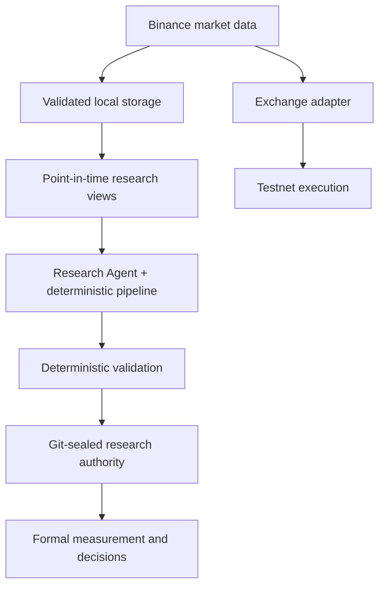

# Architecture

[English](ARCHITECTURE.md) · [繁體中文](ARCHITECTURE.zh-TW.md)

The platform separates market data, research, and execution so that each layer can fail without silently changing the meaning of the others.

## Main boundaries

**Data** handles download, normalization, integrity checks, availability, and provenance.

**Research** only consumes bounded data views. Formal measurement is separated from interpretation and stage advancement.

**Execution** uses typed domain models and `Decimal` for price, quantity, and balance calculations. Unconfirmed orders can enter an explicit `UNKNOWN` state instead of being retried blindly.

**Governance** binds formal runs and downstream transitions to tracked configs and sealed artifacts. Deterministic checks validate schema, criteria semantics, data readiness, and exact artifact identity before work advances. These checks do not establish that a scientific hypothesis or causal design is sound.

**Research automation** uses the repository's bounded control plane rather than bypassing it. Independent agent review is not a workflow gate. Human or peer critique may inform scientific judgment, but it does not create authority or replace canonical validation. After outcomes are measured, frozen methodology and evidence identity remain fixed; correctness, VOID, consumed-round repair, Stage 4 formal, and Protected Holdout decisions remain Human-controlled.
