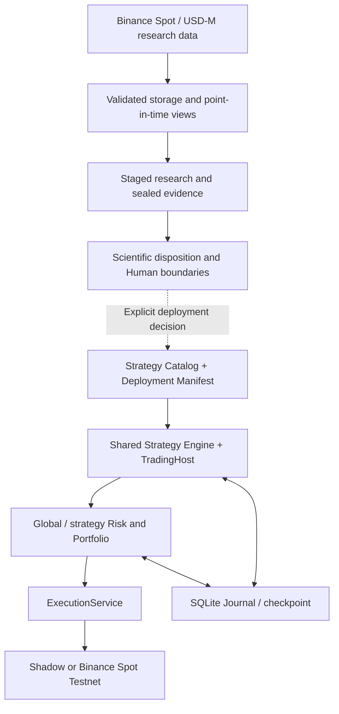

# Architecture

[English](ARCHITECTURE.md) · [繁體中文](ARCHITECTURE.zh-TW.md)

The platform separates **market data**, **scientific research**, **strategy semantics**, and **trading authority**. Valid research evidence can inform a deployment decision, but cannot place an order or automatically authorize a deployment.

## Ownership and safety boundaries

**Data plane.** Download, normalization, gap classification, availability, provenance, and strict point-in-time access. Unknown data quality is not silently declared valid.

**Research plane.** Stage 1–4 research capabilities separate measurement, interpretation, scientific disposition, and reserved authorization. Formal artifacts bind configuration, identity, and evidence. Autonomous campaigns operate only within their dispatched Stage 1–3 and bounded Stage4A preparation scope; READY integration records research history, not deployment approval.

**Shared strategy core.** Research projection and Trading share strategy definitions and lifecycle semantics (`Research → Strategy ← Trading`). The strategy engine never owns Exchange permissions.

**Deployment boundary.** A pinned Catalog entry and explicit Deployment Manifest define what Trading may load. One TradingHost may run multiple identified deployments, including separate deployments of the same strategy. Each deployment's signals, positions, checkpoints, and recovery obligations retain their own identity; the Exchange account is still shared.

**Risk and execution.** Global exposure limits and optional per-deployment static risk budgets bound new entries. Portfolio reservations are checked and persisted atomically in SQLite. TradingRuntime and ExecutionService retain the order authority; ambiguous Exchange outcomes become `UNKNOWN` and require reconciliation rather than blind retry.

**Durability.** Exchange facts take precedence over the SQLite Journal, which takes precedence over process-local hot state. Restarts cannot erase unresolved obligations or silently reinterpret deployment ownership.

## Limits

Trading supports offline replay, Shadow, and gated **Spot Testnet** only: long-only, unleveraged, no LIVE or derivatives execution. B8 multi-deployment behavior has offline E2E coverage, not an online or unattended certification.
