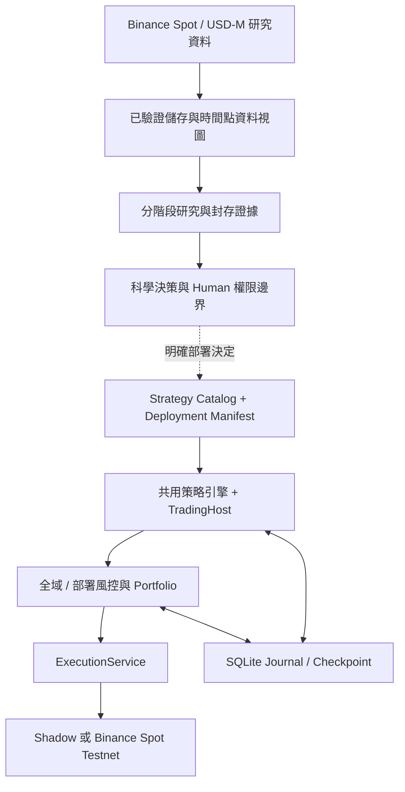

# 系統架構

[English](ARCHITECTURE.md) · [繁體中文](ARCHITECTURE.zh-TW.md)

平台把**市場資料、科學研究、策略語意與交易權限**分開。研究結果可以作為部署判斷的依據，卻不能直接觸發部署或取得送單權限。

## 模組責任與安全邊界

**資料層：** 下載、標準化、資料缺口分類、可用性、來源追蹤與時間點一致的資料存取。無法確認的資料品質不會被默認為有效。

**研究層：** Stage 1–4 研究能力將量測、解讀、科學決策與保留授權分開。Formal Artifact 綁定設定、身分及證據。自主 Campaign 僅能在 fresh dispatch 授權的 Stage 1–3 與受限 Stage4A 設計準備範圍內運作；READY 整合的是研究紀錄，不代表核准部署。

**共用策略核心：** Research Projection 與 Trading 共用策略定義及生命週期語意（`Research → Strategy ← Trading`），策略引擎本身沒有交易所權限。

**部署邊界：** 由固定的 Catalog Entry 與明確 Deployment Manifest 決定載入內容。TradingHost 可同時管理多個獨立 Deployment，同一策略也可有不同部署身分。訊號、持倉、Checkpoint 與復原義務依 Deployment 隔離，但 Exchange 帳戶仍共用。

**風控與執行：** 全域曝險上限和可選的部署級靜態風險預算限制新倉。Portfolio 的資金預留由 SQLite 原子核對與持久化；Runtime、ExecutionService 維持唯一合法送單路徑。交易所回應不明時保留 `UNKNOWN`，先對帳而非盲目重送。

**持久化：** 狀態權威依序為「Exchange 事實 ＞ SQLite Journal ＞ Process 記憶體狀態」。重啟不得抹除未完成義務，或自行推測持倉所屬的部署身分。

## 現階段限制

Trading 目前僅支援離線重播、Shadow 與受控 **Spot Testnet**：僅做多、不使用槓桿，沒有 LIVE 或衍生品交易權限。B8 多部署已有離線 E2E 覆蓋，但不代表取得線上或無人值守認證。
