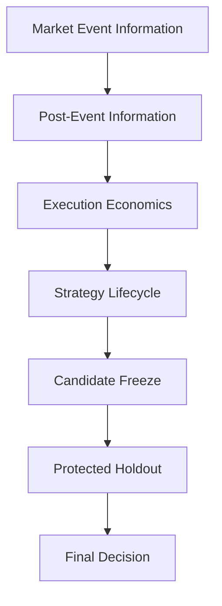

# Research Method

[English](RESEARCH_METHODOLOGY.md) · [繁體中文](RESEARCH_METHODOLOGY.zh-TW.md)

The research flow is staged so that one result cannot quietly justify a stronger claim than it measured.

## Rules that matter

**Point-in-time access** — research code only sees information that was available at that decision time.

**Outcome-blind preflight** — feasibility checks are done without reading future outcome values.

**Deterministic validation before seal** — schema, criteria, and frozen-reference checks bind the exact artifacts before their first Git seal. These checks establish artifact validity and authority, not scientific quality; peer feedback is optional.

**Separate measurement from judgment** — a completed run does not automatically mean `ADVANCE`.

**Freeze before holdout** — candidate identity and evaluation rules are fixed before protected evidence is used.

**No post-hoc rescue** — a consumed holdout is not a tuning dataset.

**Traceable authority** — configs, run artifacts, and decisions are tied to repository state and validated identities.

The platform also supports bounded agent-operated Development Research. The main Research Agent can move through Stage 1–3 under the campaign control plane, using deterministic checks for source capability, criteria semantics, exact evidence identity, and frozen artifacts. Those checks do not prove that the scientific design or interpretation is sound; peer feedback is optional and does not gate progression. Automation still does not gain authority over correctness / VOID decisions, consumed-round repair, Protected Holdout, or Stage 4 formal measurement.
