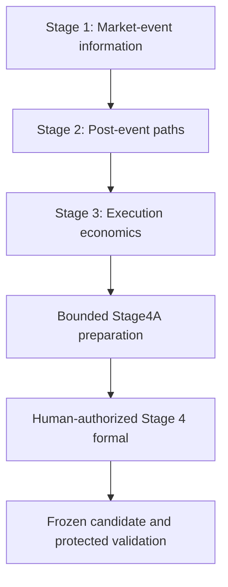

# Research Method

[English](RESEARCH_METHODOLOGY.md) · [繁體中文](RESEARCH_METHODOLOGY.zh-TW.md)

The research pipeline asks progressively stronger questions. Evidence from one stage cannot justify claims reserved for a later stage.

## Method and authority

**Point-in-time data.** A research decision may use only information available at the relevant time. Unresolved gaps are not assumed valid.

**Outcome-blind preparation.** Feasibility, sampling, comparison groups, and criteria are checked before future outcomes are exposed. The first Git seal binds exact configurations and authority artifacts.

**Separate evidence from verdicts.** A successful formal dispatch is not a scientific `ADVANCE` decision. Mechanical criteria test frozen rules; interpretation addresses effect, uncertainty, selection, coverage, and limits on claims.

**Scientific critique without invented authority.** For substantive design or interpretation decisions, the current Research Runbook calls for two separately scoped agent perspectives—methodology and evidence—coordinated by a main Research Agent. Feedback can improve judgment but is not an independent validation gate, Host-certified scientific approval, or Human authorization.

**Bounded autonomy.** Fresh campaign dispatch can authorize Agent-operated Stage 1–3 Development formal runs and bounded Stage4A preparation. Stage 4 formal, correctness/VOID, consumed-round repair, Forecast Evidence, and Protected Holdout remain Human-controlled. A consumed holdout cannot become a tuning set.

**Terminal evidence is not deployment.** A campaign's terminal lineage inventory may be sealed as READY, published, and integrated into `main` through the existing GitHub workflow. READY and even favorable Development findings are research provenance—not strategy approval, deployed status, or capital permission.

Research and Trading have separate authority boundaries. No mechanical pass, agent review, or CI integration silently upgrades a hypothesis into a live strategy.
