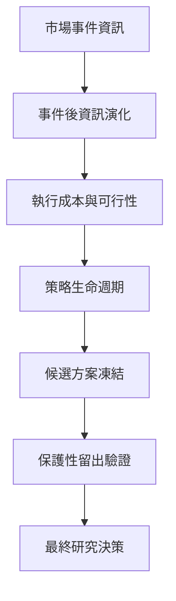

# 研究方法

[English](RESEARCH_METHODOLOGY.md) · [繁體中文](RESEARCH_METHODOLOGY.zh-TW.md)

研究流程刻意拆成多個階段，避免某個結果被拿去支持超出量測範圍的結論。

## 幾個核心規則

**只能使用當下已知的資料** — 研究程式不能看到決策時間點之後才會出現的資訊。

**預檢階段不讀未來結果** — 可行性檢查只能確認資料、設定與結構是否足夠，不能偷看未來表現。

**確定性驗證後再封存** — schema、criteria 與凍結參照檢查會在首次 Git seal 前綁定確切 artifact。這些檢查驗證 artifact 格式與 authority，不代表科學設計品質已獲認可；同儕意見屬選用。

**量測與判斷分離** — 正式研究跑完，不代表候選方案自動晉級。

**接觸留出資料前先凍結** — 候選方案與評估規則必須先固定，之後才可以使用保護性留出資料。

**不做事後救援** — 已經使用過的留出資料不能回頭拿來調參或修改規則。

**研究依據可追溯** — 設定、研究產物與決策都必須能追溯到明確的版本與身分。

平台也支援受控的自動研究流程。主要研究 Agent 可以依既定流程自主完成第一到第三階段的開發研究；deterministic validators 檢查 source capability、criteria 語意、證據 identity 與 frozen artifacts。這些檢查不會判定科學設計或解讀是否充分；同儕意見屬選用。自動化仍不能自行決定 correctness / VOID、修復已消耗輪次、使用 Protected Holdout，或執行 Stage 4 formal。
