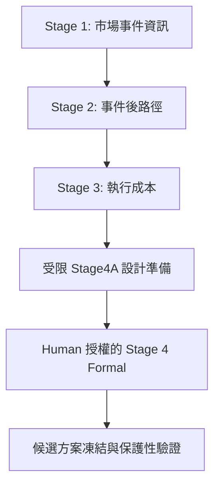

# 研究方法

[English](RESEARCH_METHODOLOGY.md) · [繁體中文](RESEARCH_METHODOLOGY.zh-TW.md)

研究流程逐步回答更強的問題；前一階段的證據不能直接推導出後一階段才有資格支持的結論。

## 研究規則與權限

**時間點一致的資料：** 研究決策只能使用當時已知的資訊；無法確認的資料缺口不能被默認有效。

**Outcome-blind 準備：** 在接觸未來結果前，先檢查可行性、樣本、控制組與判定標準。首次 Git Seal 綁定精確的設定及權限產物。

**量測不等於晉級：** Formal 執行成功，不代表科學決策自動 `ADVANCE`。機械 Criteria 檢查封存標準；研究解讀另須考慮效果、不確定性、選擇偏差、覆蓋範圍與可支持的結論。

**科學審查不產生額外權限：** 對重要的研究設計及解讀，現行 Runbook 由主要 Research Agent 協調方法與證據兩種 Reviewer 視角。意見可協助改善科學判斷，但不構成獨立的機械 Gate、由 Host 證實的科學認可或 Human 授權。

**自主研究有邊界：** Agent 依 Fresh Dispatch 可執行 Stage 1–3 Development Formal，以及受限的 Stage4A 設計準備。Stage 4 Formal、correctness/VOID、已消耗輪次修復、Forecast Evidence 與 Protected Holdout 都由 Human 控制。已使用的留出資料不能回頭調參。

**Terminal 研究紀錄不等於部署：** Campaign 完成後，合法的 Terminal Lineage 清單可封存為 READY，再發布並由 GitHub 工作流程整合到 `main`。READY 與有利的 Development 結果都只屬研究證據來源，不代表策略核准、實際部署或資金使用權限。

Research 與 Trading 保留獨立權限邊界：任何機械通過、Agent 意見或 CI 整合，都不會把研究假說悄悄升級為正式交易策略。
